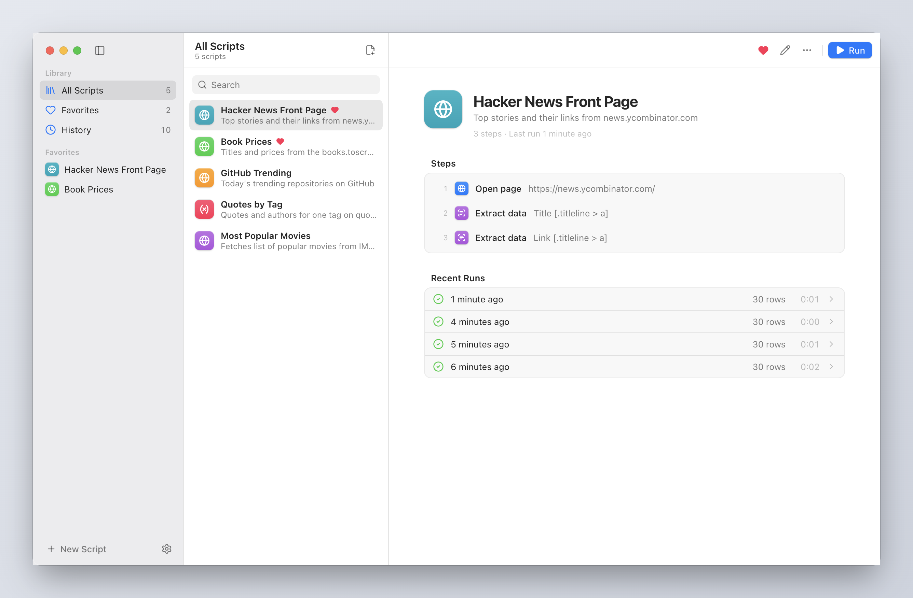
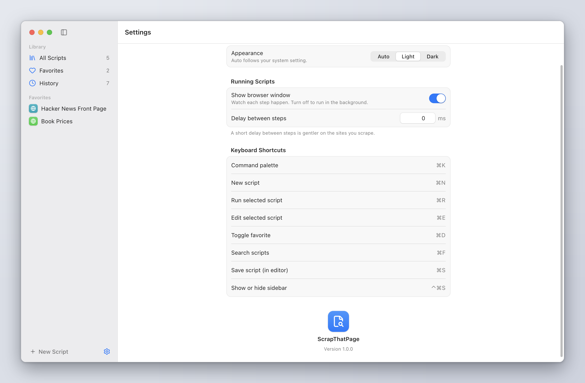
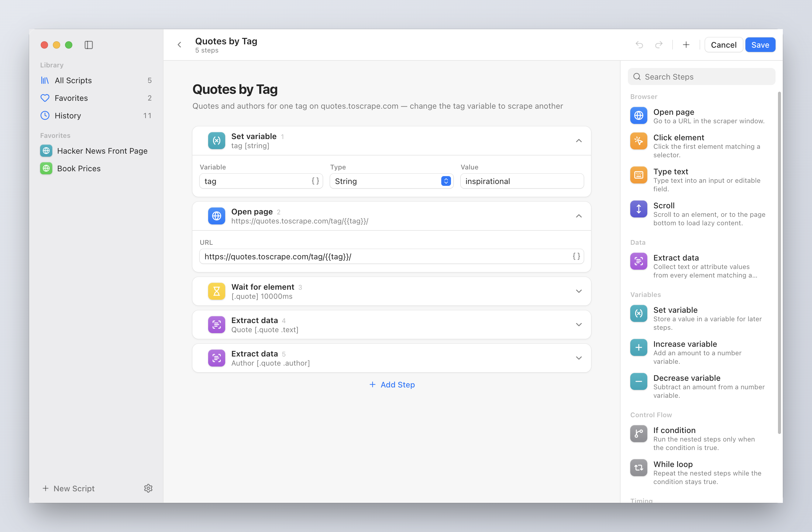
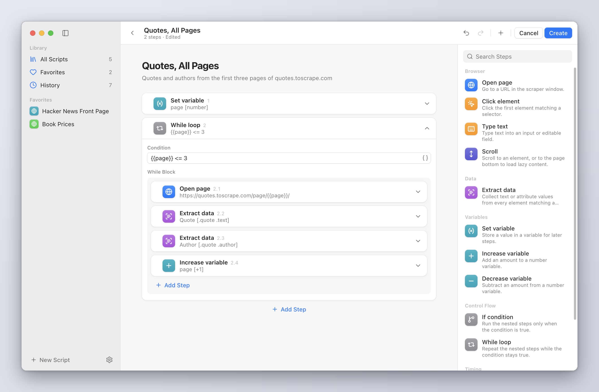
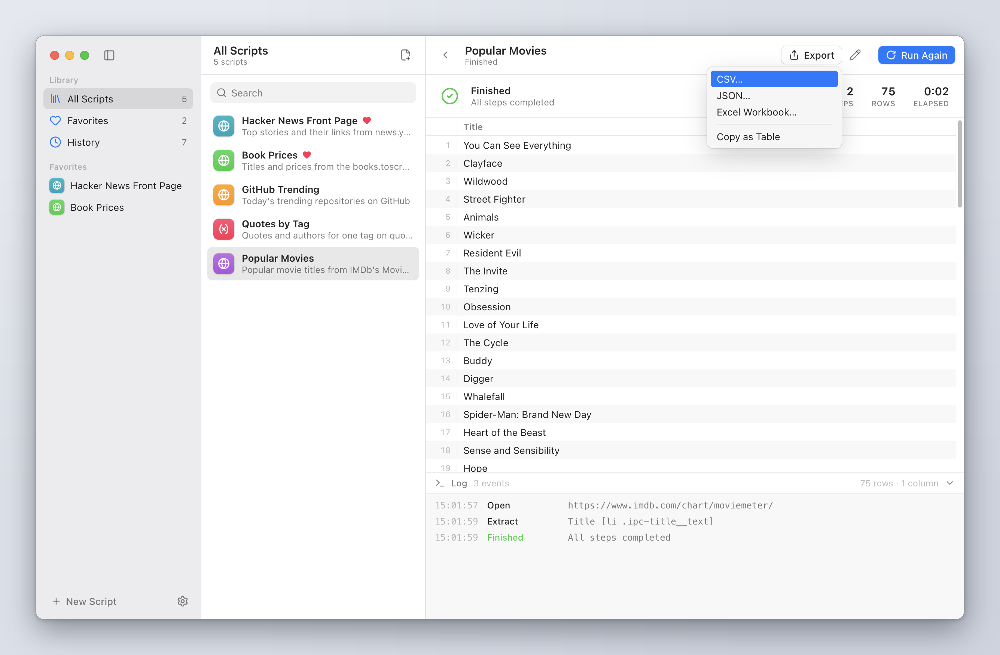
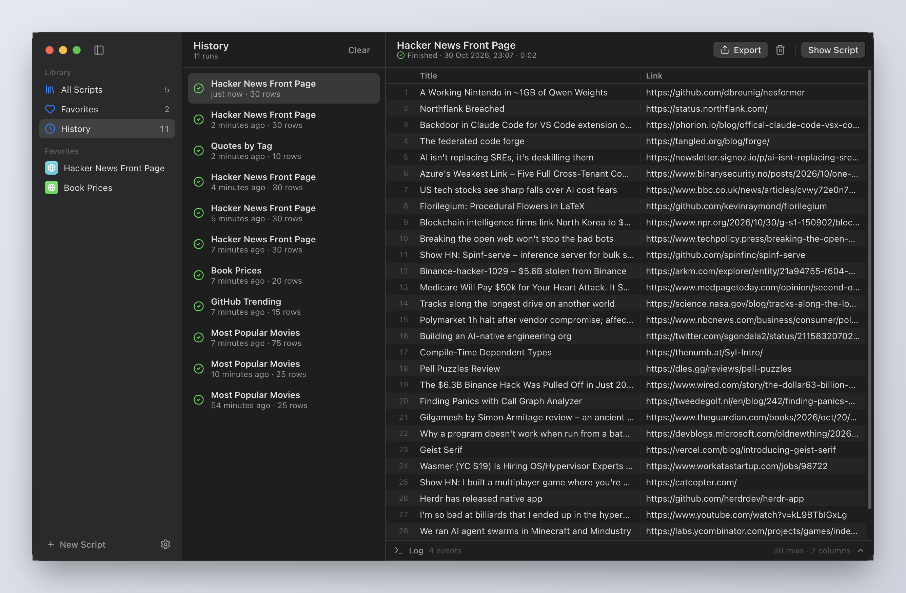
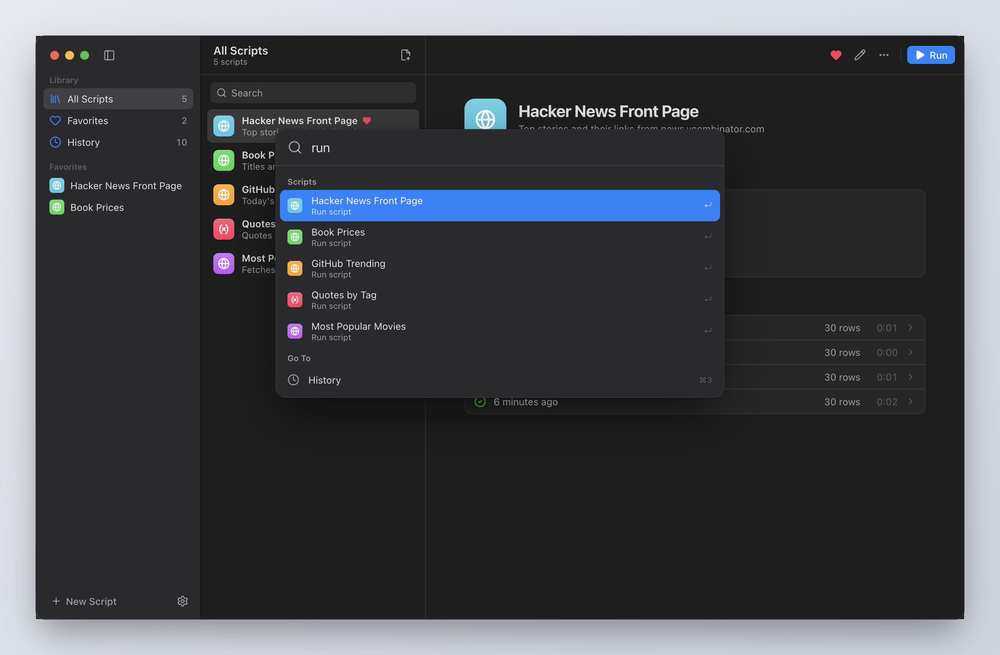
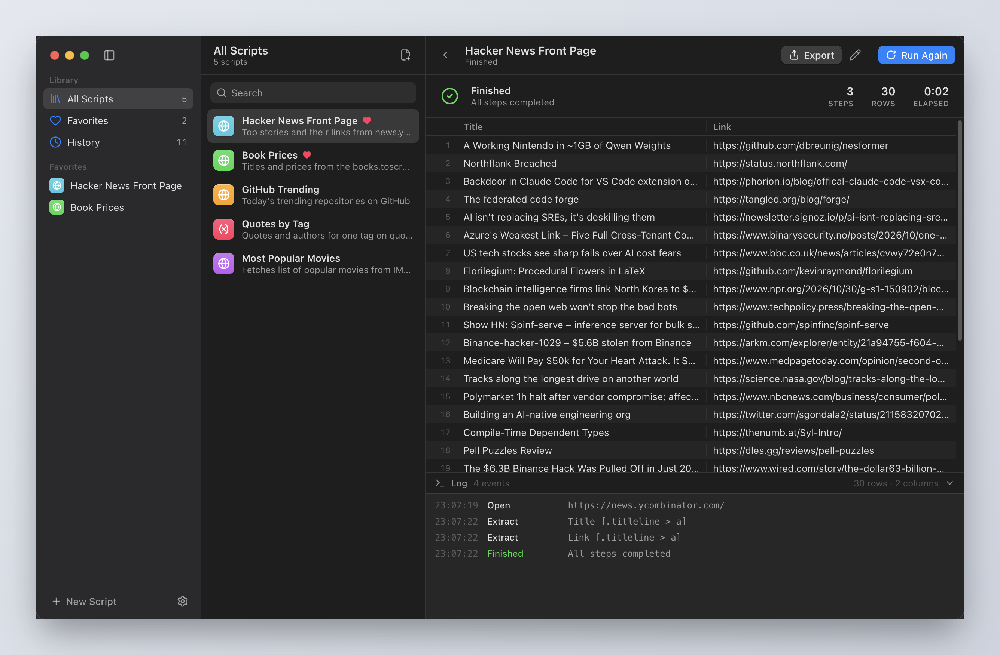

<div align="center">


# ScrapThatPage

[](LICENSE) [](https://www.electronjs.org) [](https://react.dev) [](https://www.typescriptlang.org)

**Point-and-click web scraping for the desktop — no code required.**

A cross-platform desktop app that lets you build reusable scraping scripts by
stacking simple steps — open a page, click, type, extract data — and run them
against a real browser window. Extracted values land in a table you can export
or copy.

</div>

---

## Screenshots



<table>
  <tr>
    <td width="50%"></td>
    <td width="50%"></td>
  </tr>
  <tr>
    <td width="50%"></td>
    <td width="50%"></td>
  </tr>
</table>

<details>
<summary>More screenshots</summary>

<table>
  <tr>
    <td width="50%"></td>
    <td width="50%"></td>
  </tr>
  <tr>
    <td width="50%"></td>
    <td width="50%"></td>
  </tr>
</table>

</details>

## Features

- **Feels like a Mac app** — a translucent source-list sidebar, list + detail
  panes under a unified toolbar, native menu bar, light and dark appearance,
  and controls modeled on AppKit.
- **Visual script builder** — stack steps as Shortcuts-style blocks from an
  always-visible step library; drag to reorder, undo/redo, inline name and
  description.
- **Browser steps** — `open` a URL, `click` an element, `type` into a field,
  `extract` values by CSS selector and attribute, plus `wait`, `delay`, and
  `scroll`.
- **Element picker** — click an element in the scraper window and its CSS
  selector is filled in for you.
- **Reliable execution** — steps auto-wait for their target to appear before
  acting; runs can be headless and paced with a configurable delay between steps.
- **Variables and control flow** — `set`/`increase`/`decrease` variables and
  branch or loop with `if`/`while`; reference variables in inputs with
  `{{variable}}` placeholders.
- **Live results** — runs play next to your script list: a fast, striped results
  table fills in as data is extracted, with a step-by-step log underneath.
  Export to **CSV**, **JSON**, or **XLSX**, or copy to the clipboard.
- **Run history** — every run is saved with its results and log.
- **Keyboard first** — `⌘K` command palette, `⌘R` run, `⌘E` edit, `⌘N` new
  (`Ctrl` on Windows and Linux), arrow-key navigation, and right-click menus.
- **Library management** — search, favorite, duplicate, delete, and
  import/export scripts as JSON. New installs start with five sample scripts
  (Hacker News, GitHub Trending, book prices, quotes, IMDb).
- **Local-first** — scripts and runs are stored on-device in IndexedDB; nothing
  leaves your machine.

## How It Works

Scripts run in a dedicated Chromium window that ScrapThatPage drives over the
**Chrome DevTools Protocol** using Electron's in-process
`webContents.debugger`. That means no remote debugging port is opened, so
scraping keeps working in the signed, packaged app — while still getting
Puppeteer-style ergonomics: navigation waits for the document, actions auto-wait
for their selector, clicks and typing dispatch trusted input events, and hidden
windows stay active so lazily rendered content still loads.

## Tech Stack

| Area          | Tools                                                                                                                                                                                                                                                                                                   |
| ------------- | ------------------------------------------------------------------------------------------------------------------------------------------------------------------------------------------------------------------------------------------------------------------------------------------------------- |
| **Framework** | [Electron](https://www.electronjs.org/) + [Electron Forge](https://www.electronforge.io/) · [Vite](https://vite.dev/)                                                                                                                                                                                   |
| **UI**        | [React 19](https://react.dev/) · [Base UI](https://base-ui.com/) · [Tailwind CSS v4](https://tailwindcss.com/) · [Motion](https://motion.dev/)                                                                                                                                                          |
| **State**     | [Zustand](https://zustand.docs.pmnd.rs/) (with [zundo](https://github.com/charkour/zundo) for undo/redo) · [Dexie](https://dexie.org/) (IndexedDB) · [Zod](https://zod.dev/)                                                                                                                            |
| **Testing**   | [Vitest](https://vitest.dev/)                                                                                                                                                                                                                                                                           |
| **Tooling**   | [TypeScript](https://www.typescriptlang.org/) (strict) · [oxlint](https://oxc.rs/docs/guide/usage/linter) · [oxfmt](https://oxc.rs/docs/guide/usage/formatter) · [oxlint-tailwindcss](https://www.npmjs.com/package/oxlint-tailwindcss) (lint and format, Tailwind class sorting and canonical classes) |

## Getting Started

These instructions will get you a copy of the project up and running on your
local machine for development purposes.

### Requirements

To install and run this project you need:

- [Node.js](https://nodejs.org/) 20.19+ (or 22.12+)
- [pnpm](https://pnpm.io/) 10+
- [git](https://git-scm.com/downloads) (only to clone this repository)

### Installation

To set up everything on your local machine, follow these steps:

1. Clone this repo and then change directory to the `scrap-that-page` folder:

```bash
git clone https://github.com/kaushalmeena/scrap-that-page.git
cd scrap-that-page
```

2. Install project dependencies using pnpm:

```bash
pnpm install
```

### Running

To run the app in development with hot reload:

```bash
pnpm start
```

### Testing

To check formatting, lint, typecheck and run the unit tests together:

```bash
pnpm check
```

`pnpm format` formats the codebase (oxfmt, including Tailwind class order)
and `pnpm lint:fix` applies auto-fixable lint findings (e.g. non-canonical
Tailwind classes).

### Code organization

Everything sits one level under `src/`, grouped by role, behind a single `@/`
import alias:

```text
main/  preload/            Electron processes (Node)
types/  constants/  utils/ shared by every process, kept pure
app/                       window shell, router, sidebar, command palette
components/                macOS-style component kit (Base UI + design tokens)
lib/                       renderer-only modules (commands, motion, platform)
database/                  IndexedDB storage
features/
  <feature>/
    *Screen.tsx   top-level route
    *Pane.tsx     nested route rendered in a screen's detail pane
    components/   feature-only components
    hooks/  context/  store/  utils/
```

Conventions: handlers are named functions declared above the `return`
(no inline functions in JSX — enforced by `local/no-inline-jsx-function`),
and every script side effect goes through `features/scripts/utils/actions`.

### Building

To build distributable installers/archives for the current platform:

```bash
pnpm make
```

Artifacts are written to `out/`. Forge is configured to produce a Squirrel
installer (Windows), a ZIP (macOS), and `.deb` / `.rpm` packages (Linux); build
on the target OS to produce that platform's package.

## Contributing

Contributions are welcome! If you find a bug or have a feature request, please
[open an issue](https://github.com/kaushalmeena/scrap-that-page/issues/new/choose)
first to discuss it. For code changes, fork the repository, create a branch,
and open a pull request.

## License

This project is licensed under the MIT License — see the [LICENSE](LICENSE)
file for details.
